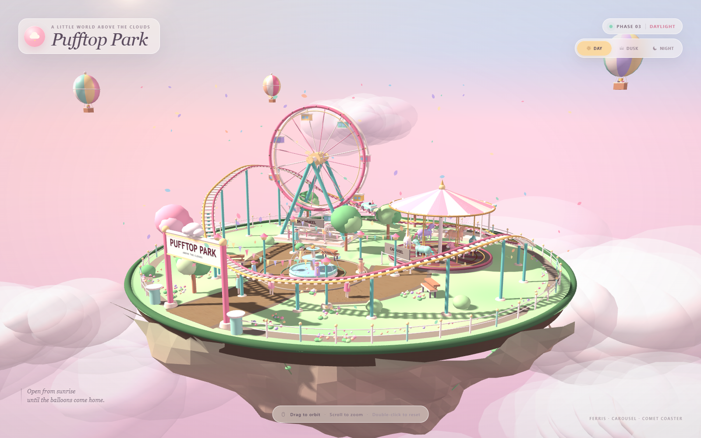
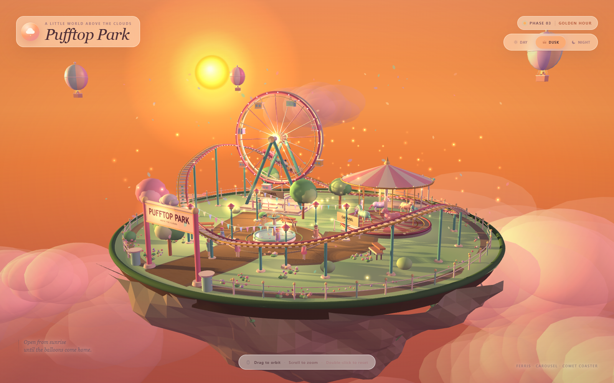
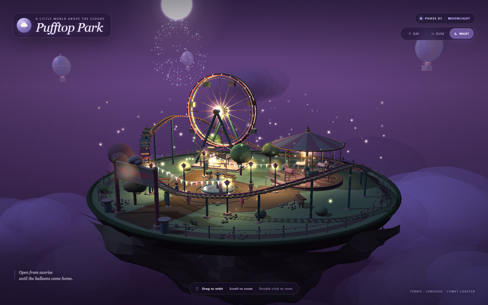
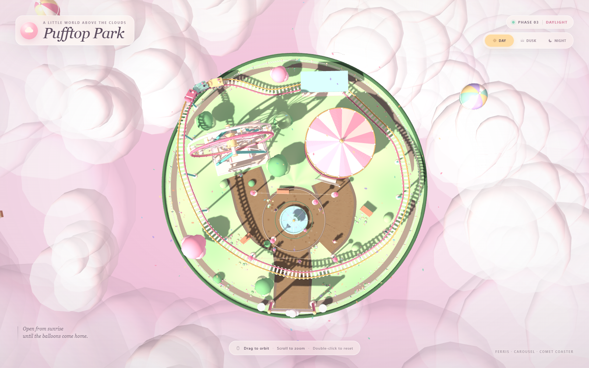

# Pufftop Park

A small, interactive amusement park adrift above the clouds — with three lighting moods, drifting petals and fireflies, a choreographed night firework show, and a night-only bloom pass.

Built with **Three.js** using only primitive geometry, procedural canvas textures and vertex-colour batching — no external models, image assets or build step.









## Run it

The project is fully offline. Either:

1. Open `index.html` directly in a browser, or
2. Serve the folder and open the local address:

```bash
cd cloud-park
python -m http.server 8765
# http://127.0.0.1:8765
```

WebGL is required.

## Day / Sunset / Night

Use the three-state switch in the top-right corner. **Day is the default**; the scene blends to the selected mood over ~1.7 seconds.

**Day mode** uses a pink-peach sky gradient, soft pink fog and pale clouds. Every practical light, bulb emissive and facility halo is switched off, so the rides are lit only by the sky. Pastel petals drift through the air instead of glowing motes.

**Sunset mode** (Dusk):

- a warm sky dome with a deep-orange horizon fading into honey-amber and soft pink above;
- a low sun disc and halo near the horizon;
- the key directional light turns warm amber (`#FFB347`) and drops to a low angle for long evening shadows;
- purple/pink fill and bounce lighting keep the shadows romantic rather than muddy;
- a subtle warm fog turns the clouds into candy-floss puffs;
- fireflies stay visible but shift to a golden early-evening tint;
- Ferris wheel, carousel and street lamps switch on at a softer level than at night;
- bloom stays off, preserving the painterly sunset look.

**Night mode**:

- a dreamy violet `#2F1B41` sky, 520 stars and a moon;
- a much lower ambient level so the warm practical lights read;
- 8 amber/gold point lights at the Ferris hub, under the carousel canopy and at every street lamp;
- high-emissive bulb materials, larger glowing fireflies and a choreographed firework show;
- **EffectComposer + UnrealBloomPass** for the soft luminous glow.

Returning to **Day** hides fireflies and fireworks, disables bloom, restores the pastel daylight baseline, and fades away the sunset/night sky domes and suns.

## What is in the scene

- **The floating island** — a flat, gently undulating grass top wrapped over a tall, irregular rock underside. Dangling vines break up the cliff edges, and every flower and pebble is kept inside the island rim.
- **Ferris wheel** — a pink-and-cream wheel with 16 spokes, crossbars joining both rims, 8 pastel gondolas hung from the crossbar centres and a hand-painted-looking sign, so the hanger cables stay in the wheel plane.
- **Carousel** — a striped canopy, painted radial floor that turns with the ride, brass poles and six bobbing horses, rotating clockwise, each with its own pink, mint, cream, lavender, peach or seafoam coat. It now sits on the upper-right lawn, clear of the fountain and its relocated tree.
- **Comet coaster** — a closed, banked circuit around the island rim with mint supports, pastel rails, a station and a three-car train that continuously runs the track. The rails now pass through the centre of the station shed.
- **Clouds** — dozens of soft, semi-transparent sphere puffs merged into single geometries. They drift slowly around the island and form a low cloud sea.
- **Hot-air balloons** — striped sphere envelopes, rope rigging, tiny baskets and burner glows.
- **Park dressing** — an entrance arch, bunting, lamp posts, flower beds, topiary, a fountain, benches and tiny visitors.
- **Petals** — 96 soft petal-shaped points in pink, mint, cream, lavender, peach and sky drift down around the island; a custom point shader gives each a different size, spin, fall direction and near-camera fade. They are hidden at Night so the fireworks stay the focus.
- **Fireworks** — launch rockets rise from the park, then peony, ring and willow shells burst above the island with short trails, a colored core flash and a soft local light. Each small show uses two shells spaced about 2.8 seconds apart, with a larger finale every third show.
- **Motion** — the island breathes, the wheel and carousel turn, horses bob, the coaster train runs, balloons float and the camera drifts after a period of inactivity.

## Controls

| Action | Control |
| --- | --- |
| Switch Day / Sunset / Night | Top-right segmented switch |
| Keyboard mode switch | `1` Day · `2` Sunset · `3` Night |
| Rotate the island | Drag (mouse or one finger) |
| Zoom | Scroll wheel or pinch |
| Reset the view | Double-click / double-tap |
| Idle camera drift | Begins automatically after 18 seconds |

The portrait layout widens the orbit framing, compacts the mode switch to icons, and shows a short first-run Day · Dusk · Night hint so the island and controls both fit.

## Project structure

```text
cloud-park/
├─ index.html
├─ css/
│  └─ style.css          // HUD, three-mode theme, loading and responsive layout
├─ js/
│  ├─ core.js            // palette, shared materials, geometry merge helpers,
│  │                     //   canvas textures, ribbons and bunting
│  ├─ controls.js        // dependency-free OrbitControls-style camera
│  ├─ world.js           // renderer, sky, lights, island, clouds, petals
│  ├─ rides.js           // ferris wheel, carousel, coaster + train
│  ├─ park.js            // paths, entrance, fence, lamps, fountain,
│  │                     //   planting, balloons, visitors and balloon material
│  ├─ atmosphere.js      // three-state lighting blend, sky domes, stars,
│  │                     //   moon, sunset sun, firefly tint
│  ├─ particles.js       // fireflies point system
│  ├─ postfx.js          // night-only composer / bloom wrapper
│  ├─ fireworks.js       // launched shells, trails, flash and show choreography
│  ├─ main.js            // bootstrap, three-state UI, animation loop, framing
│  └─ vendor/
│     ├─ three.min.js    // Three.js r97, vendored for offline playback
│     └─ addons/
│        ├─ EffectComposer.js
│        ├─ RenderPass.js
│        ├─ ShaderPass.js
│        └─ UnrealBloomPass.js
├─ THREE-LICENSE.txt
├─ screenshot-day.png
├─ screenshot-dusk.png
├─ screenshot-night.png
├─ screenshot-top.png
├─ screenshot-mobile-day.png
├─ screenshot-mobile-dusk.png
└─ screenshot-mobile-night.png
```

### Notes on the Three.js build

The runtime ships with **Three.js r97** from the `pythreejs` source distribution. r97 predates a few modern APIs, so `core.js` aliases `BufferGeometry.setAttribute` to its `addAttribute` and the code uses the `*BufferGeometry` variants throughout. The `<script>`-style post-processing addons are vendored, r97-compatible adaptations of the classic `examples/js` surface.

One r97 detail matters for custom post-processing: `renderer.render(scene, camera, target)` resets to its **third argument**, so every render-to-target pass passes the target explicitly. `EffectComposer` and bloom are used only while Night is active; Day and Sunset render straight through `WebGLRenderer`.

## Palette

The macaron palette lives in one place — `Pufftop.C` in `js/core.js`:

`cream · pink · rose · blush · peach · butter · lemon · mint · seafoam · sky · lavender · pastel grass · warm stone`

Day, Sunset and Night lighting values live together in `PRESETS` inside `js/atmosphere.js`, so the three looks are easy to re-tune side by side.

## Performance

Day mode draws roughly **120 draw calls / 180k triangles**. Sunset renders directly with the same scene, adding no post-processing cost. Night mode renders through the composer at renderer resolution, with the bloom blur chain at half resolution. Repeated small details (flowers, fence posts, cloud puffs, horse parts, wheel spokes, track ties and supports) are merged into vertex-coloured geometries to keep the base scene light.
